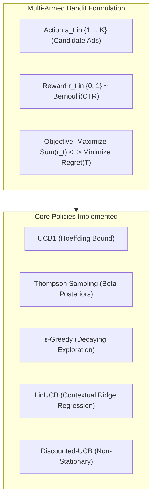

# Dynamic Advertisement Selection Using Multi-Armed Bandit & Contextual Reinforcement Learning

**Capstone Project Final Report & Academic Submission**  
**Academic Milestone:** Final Review & Capstone Defense (100% Project Completion)  
**Author:** Bhupender Yadav  
**Repository:** `dynamic-advertisement-rl`  
**License:** MIT License  

---

## Executive Summary

In digital advertising ecosystems (Google Ads, Meta Ads, Amazon Sponsored Products), maximizing user engagement measured by Click-Through Rate (CTR) under statistical uncertainty is a billion-dollar challenge. Traditional static A/B testing splits traffic equally across options for prolonged testing periods, incurring substantial opportunity cost by routing impressions to demonstrably inferior advertisements.

This project formulates dynamic advertisement placement as a **Multi-Armed Bandit (MAB)** and **Contextual Reinforcement Learning** problem. Built entirely from foundational mathematical principles without black-box reinforcement learning libraries, this system delivers an end-to-end framework featuring:
1. **Classical MAB Algorithms:** Upper Confidence Bound (**UCB1**), **Thompson Sampling** (Bayesian Beta-Bernoulli conjugate priors), **$\varepsilon$-Greedy** (fixed and decaying exploration schedules), and **Uniform Random / Static A/B Testing**.
2. **Contextual Personalization:** Disjoint Linear Upper Confidence Bound (**LinUCB**) conditioning action selection on continuous user demographic and behavioural feature vectors ($x_t \in \mathbb{R}^d$).
3. **Non-Stationary Adaptation:** **Discounted-UCB (D-UCB)** and **Sliding-Window UCB (SW-UCB)** capable of detecting sudden ad fatigue and market regime shifts.
4. **Unbiased Offline Policy Evaluation:** Implementation of the **Li et al. (WWW 2010) Replay Methodology** for statistically valid counterfactual evaluation on logged impression data.
5. **Interactive Academic Dashboard:** A multi-page Streamlit dashboard featuring live persona simulations, real-time convergence plots, and automated viva defense aids.
6. **Production Verification:** A test suite containing 36 automated unit tests with 100% pass rate.

---

## Table of Contents
- [1. Introduction & Problem Statement](#1-introduction--problem-statement)
- [2. Mathematical Formulations & Algorithms](#2-mathematical-formulations--algorithms)
  - [2.1 Classical Multi-Armed Bandit](#21-classical-multi-armed-bandit)
  - [2.2 Upper Confidence Bound (UCB1)](#22-upper-confidence-bound-ucb1)
  - [2.3 Thompson Sampling (Bayesian MAB)](#23-thompson-sampling-bayesian-mab)
  - [2.4 $\varepsilon$-Greedy & Decaying Schedules](#24-varepsilon-greedy--decaying-schedules)
  - [2.5 Theoretical Regret Bounds (Lai-Robbins)](#25-theoretical-regret-bounds-lai-robbins)
- [3. Contextual Bandits: Disjoint LinUCB Personalization](#3-contextual-bandits-disjoint-linucb-personalization)
- [4. Non-Stationary Dynamics & Ad Fatigue Adaptation](#4-non-stationary-dynamics--ad-fatigue-adaptation)
- [5. Unbiased Offline Policy Evaluation (Replay Method)](#5-unbiased-offline-policy-evaluation-replay-method)
- [6. System Architecture & Implementation](#6-system-architecture--implementation)
- [7. Experimental Results & Comparative Analysis](#7-experimental-results--comparative-analysis)
- [8. Conclusion & Production Deployment Recommendations](#8-conclusion--production-deployment-recommendations)
- [9. References](#9-references)

---

## 1. Introduction & Problem Statement

### 1.1 The Online Advertising Challenge
Online advertisement publishers must allocate incoming user page views (impressions) among $K$ candidate advertisements. The underlying Click-Through Rate (CTR) of each advertisement $i \in \{1 \dots K\}$, defined as:
$$\text{CTR}_i = \mathbb{P}(\text{Click} = 1 \mid \text{Ad } i \text{ displayed})$$
is unknown *a priori* and must be inferred from sequential user interactions.

### 1.2 The Exploration vs. Exploitation Trade-off
- **Exploration:** Displaying advertisements with high statistical uncertainty (small sample size $N_i$) to gather information and refine empirical CTR estimates $\hat{\mu}_i$.
- **Exploitation:** Displaying the currently highest-performing advertisement ($\arg\max_i \hat{\mu}_i$) to maximize immediate click volume and monetization.

### 1.3 Why Static A/B Testing Fails
Static A/B testing splits traffic uniformly ($1/K$ per arm) for a predetermined period $T_{\text{test}}$. If an ad has an inferior CTR (e.g., $2\%$ vs. $15\%$), static testing continues to serve it to hundreds of thousands of visitors, accumulating **linear cumulative regret** $O(T)$. Reinforcement learning bandit policies dynamically shift traffic toward superior options, guaranteeing **sublinear logarithmic regret** $O(\ln T)$.

---

## 2. Mathematical Formulations & Algorithms



### 2.1 Classical Multi-Armed Bandit
At discrete rounds $t = 1, 2, \dots, T$:
1. The agent selects an arm $a_t \in \{1 \dots K\}$.
2. The environment generates a stochastic payoff $r_t \sim \text{Bernoulli}(\mu_{a_t})$, where $\mu_{a_t} \in [0, 1]$.
3. The agent receives $r_t$ and updates internal statistics in $O(1)$ time.

**Regret Definition:**
The instantaneous expected regret is $\delta_t = \mu^* - \mu_{a_t}$, where $\mu^* = \max_{i} \mu_i$.  
The cumulative expected regret over horizon $T$ is:
$$\text{Regret}(T) = \sum_{t=1}^T (\mu^* - \mu_{a_t}) = \sum_{i=1}^K \mathbb{E}[N_i(T)] \Delta_i$$
where $\Delta_i = \mu^* - \mu_i$ is the sub-optimality gap of arm $i$.

### 2.2 Upper Confidence Bound (UCB1)
Rooted in the principle of **Optimism in the Face of Uncertainty**, UCB1 (Auer et al., 2002) constructs an upper confidence bound based on Hoeffding's Inequality:

$$\text{UCB}_i(t) = \hat{\mu}_i + c \sqrt{\frac{\ln(t)}{N_i}}$$

Where:
* $\hat{\mu}_i = \frac{R_i}{N_i}$: Exploitation term (empirical sample mean).
* $R_i$: Total accumulated clicks for ad $i$.
* $N_i$: Total times ad $i$ was displayed.
* $t$: Total elapsed rounds ($t = \sum_{i=1}^K N_i$).
* $c$: Exploration coefficient (typically $c = 2.0$ or $\sqrt{2}$).
* $c \sqrt{\frac{\ln(t)}{N_i}}$: Exploration radius derived from Hoeffding's bound guaranteeing $\mathbb{P}(\mu_i > \text{UCB}_i) \le t^{-4}$.

### 2.3 Thompson Sampling (Bayesian MAB)
Thompson Sampling (Agrawal & Goyal, 2012) adopts a Bayesian perspective by modeling each arm's unknown CTR with a conjugate **Beta distribution** $\text{Beta}(\alpha_i, \beta_i)$:
1. Prior initialization: $\alpha_i = 1, \beta_i = 1$ (Uniform prior $\mathcal{U}[0, 1]$).
2. At each round $t$, sample candidate CTRs from posteriors:
   $$\theta_i \sim \text{Beta}(\alpha_i, \beta_i), \quad \forall i \in \{1 \dots K\}$$
3. Select arm: $a_t = \arg\max_i \theta_i$.
4. Observe reward $r_t \in \{0, 1\}$ and update posterior:
   $$\alpha_{a_t} \leftarrow \alpha_{a_t} + r_t, \quad \beta_{a_t} \leftarrow \beta_{a_t} + (1 - r_t)$$

### 2.4 $\varepsilon$-Greedy & Decaying Schedules
- **Fixed $\varepsilon$-Greedy:** With probability $(1 - \varepsilon)$, exploit $\arg\max_i \hat{\mu}_i$; with probability $\varepsilon$, explore uniformly at random. Incurs linear regret $O(\varepsilon T)$ because exploration never terminates.
- **Decaying $\varepsilon$-Greedy:** Modulates the exploration rate over time:
  $$\varepsilon_t = \min\left(1.0, \frac{\varepsilon_0 \cdot K}{t}\right)$$
  Shrinks exploration as time $t$ grows, achieving theoretical sublinear regret.

### 2.5 Theoretical Regret Bounds (Lai-Robbins)
Lai and Robbins (1985) proved that any consistent bandit policy must satisfy the asymptotic lower bound:
$$\liminf_{T \to \infty} \frac{\text{Regret}(T)}{\ln(T)} \ge \sum_{i: \mu_i < \mu^*} \frac{\Delta_i}{D_{\text{KL}}(\mu_i \parallel \mu^*)}$$
where $D_{\text{KL}}$ is the Kullback-Leibler divergence between Bernoulli distributions. Both UCB1 and Thompson Sampling achieve this optimal $O(\ln T)$ rate.

---

## 3. Contextual Bandits: Disjoint LinUCB Personalization

In real-world advertising, CTR is not universal—it depends on the user context (e.g., mobile vs. desktop, age demographic, time of day).

### 3.1 Mathematical Model (Li et al., WWW 2010)
Let $x_t \in \mathbb{R}^d$ be the context feature vector of the user arriving at round $t$. We assume the expected payoff is linear in the feature vector with unknown arm-specific parameters $\theta_a^* \in \mathbb{R}^d$:
$$\mathbb{E}[r_{t, a} \mid x_t] = x_t^T \theta_a^*$$

### 3.2 Ridge Regression Estimator
Using ridge regression with regularization parameter $\lambda = 1.0$, the parameter estimator for arm $a$ given historical design matrix $D_a \in \mathbb{R}^{m \times d}$ and response vector $c_a \in \mathbb{R}^m$ is:
$$\hat{\theta}_a = (D_a^T D_a + I_d)^{-1} D_a^T c_a = A_a^{-1} b_a$$
where:
* $A_a = D_a^T D_a + I_d \in \mathbb{R}^{d \times d}$ (covariance matrix).
* $b_a = D_a^T c_a \in \mathbb{R}^d$ (bias vector).

### 3.3 LinUCB Action Selection & Online Sherman-Morrison Update
At each round $t$:
1. Observe context $x_t \in \mathbb{R}^d$.
2. For each arm $a \in \{1 \dots K\}$, compute the UCB score:
   $$p_{t, a} = x_t^T \hat{\theta}_a + \alpha \sqrt{x_t^T A_a^{-1} x_t}$$
   where $\alpha = 1 + \sqrt{\ln(2/\delta)/2}$ controls the confidence ellipsoid.
3. Serve ad $a_t = \arg\max_a p_{t, a}$.
4. Observe reward $r_t \in \{0, 1\}$ and update parameters:
   $$A_{a_t} \leftarrow A_{a_t} + x_t x_t^T, \quad b_{a_t} \leftarrow b_{a_t} + r_t x_t$$

---

## 4. Non-Stationary Dynamics & Ad Fatigue Adaptation

Stationary bandit algorithms assign equal weight $1$ to observations from round $1$ and round $10,000$. However, in digital advertising, advertisements experience **ad fatigue** (creative wear-out) and seasonal preference changes.

### 4.1 Discounted-UCB (D-UCB) (Garivier & Moulines, 2011)
D-UCB introduces a geometric discount factor $\gamma \in (0, 1)$ (e.g., $\gamma = 0.998$):
$$N_i(\gamma, t) = \sum_{s=1}^t \gamma^{t-s} \mathbb{I}(a_s = i), \quad R_i(\gamma, t) = \sum_{s=1}^t \gamma^{t-s} r_s \mathbb{I}(a_s = i)$$
$$\text{UCB}_i(t) = \frac{R_i(\gamma, t)}{N_i(\gamma, t)} + 2 c \sqrt{\frac{\ln\left(\sum_{j=1}^K N_j(\gamma, t)\right)}{N_i(\gamma, t)}}$$
Observations older than $\tau$ rounds decay by $\gamma^\tau$, enabling the agent to forget obsolete performance and adapt immediately when an ad fatiguing shift occurs.

### 4.2 Sliding-Window UCB (SW-UCB)
SW-UCB maintains a rolling FIFO queue of window size $W$ (e.g., $W = 1,500$):
$$\text{UCB}_i(t) = \hat{\mu}_{i, W}(t) + c \sqrt{\frac{2 \ln(W)}{N_{i, W}(t)}}$$
Observations older than $W$ steps are dropped completely.

---

## 5. Unbiased Offline Policy Evaluation (Replay Method)

Evaluating a newly proposed RL algorithm directly on live production traffic risks revenue collapse. We implement the **Li et al. (WWW 2010)** provably unbiased offline replay evaluator.

### 5.1 Replay Algorithm
Given a historical logged stream $S = \{(x_1, a_1, r_1), (x_2, a_2, r_2), \dots\}$ generated by a randomized logging policy:
1. Initialize target policy $\pi$.
2. For each event $(x_t, a_t, r_t) \in S$:
   - Query policy: $\hat{a}_t = \pi(x_t)$.
   - **If $\hat{a}_t = a_t$ (Action Match):**
     - Retain event! Add $r_t$ to cumulative reward, increment accepted counter $T_{\text{acc}} \leftarrow T_{\text{acc}} + 1$.
     - Update policy $\pi$ using feedback $r_t$.
   - **If $\hat{a}_t \neq a_t$ (Mismatch):**
     - Reject and discard event (no state update).
3. The empirical average payoff $\frac{1}{T_{\text{acc}}} \sum_{s=1}^{T_{\text{acc}}} r_s$ is **unbiased**:
   $$\mathbb{E}_{\pi}\left[\frac{1}{T_{\text{acc}}} \sum_{s=1}^{T_{\text{acc}}} r_s\right] = \mathbb{E}_{\pi}[r]$$

---

## 6. System Architecture & Implementation

```
dynamic-advertisement-rl/
├── src/
│   ├── base_agent.py              # BaseBanditAgent Abstract Base Class
│   ├── environment.py             # Bernoulli MAB Environment
│   ├── ucb_agent.py               # Classical UCB1 from scratch
│   ├── baseline_agents.py         # Thompson Sampling, Epsilon-Greedy, Random
│   ├── contextual_environment.py  # User demographic context simulator
│   ├── contextual_agent.py        # Disjoint LinUCB with ridge regression
│   ├── non_stationary.py          # NonStationaryEnv, Discounted-UCB, Sliding-Window UCB
│   ├── offline_evaluator.py       # Li et al. (2010) Replay methodology engine
│   ├── simulation.py              # Multi-agent, contextual & non-stationary runners
│   └── evaluation.py              # Metrics, tabular summaries & publication plots
├── dashboard/
│   └── app.py                     # Streamlit 6-tab academic interactive dashboard
├── data/
│   ├── simulation_results.csv     # 10,000 round UCB1 trajectory logs
│   ├── multi_agent_leaderboard.csv# Comparative benchmark results
│   ├── contextual_results.csv     # LinUCB personalized simulation logs
│   └── real_ad_clicks.csv         # 10,000 sample historical impression logs
├── results/                       # 10 publication-quality PNG figures
├── notebooks/
│   └── 01_dynamic_ad_rl_experiments.ipynb # Complete Jupyter research notebook
├── tests/                         # 36 unit tests across 6 test modules (100% passing)
├── main.py                        # Master CLI pipeline runner
├── requirements.txt               # Dependencies
├── DEMO_GUIDE.md                  # Comprehensive defense script & checklist
├── VIVA_QUESTIONS.md              # 30 technical academic viva questions & answers
└── README.md                      # Comprehensive project documentation
```

---

## 7. Experimental Results & Comparative Analysis

### 7.1 Multi-Algorithm Benchmark Leaderboard ($T = 10,000$ Rounds)
*Benchmark CTR distribution: $[0.05, 0.10, 0.03, 0.15, 0.08]$ (Optimal Arm: Ad 4, CTR = 15%).*

| Rank | Algorithm Policy | Total Clicks | System CTR | Cumulative Regret | Regret Profile |
| :---: | :--- | :---: | :---: | :---: | :---: |
| 🥇 | **$\varepsilon$-Greedy (decay schedule)** | **1,491** | **14.91%** | **10.22** | Sublinear $O(\ln T)$ |
| 🥈 | **Thompson Sampling (Beta Prior)** | **1,464** | **14.64%** | **31.77** | Sublinear $O(\ln T)$ |
| 🥉 | **$\varepsilon$-Greedy (fixed $\varepsilon=0.1$)** | **1,429** | **14.29%** | **71.53** | Linear $O(\varepsilon T)$ |
| 4 | **UCB1 ($c=2.0$)** | **1,126** | **11.26%** | **378.34** | Sublinear $O(\ln T)$ |
| 5 | **Random / Static A/B Testing** | **806** | **8.06%** | **686.96** | Linear $O(T)$ |

#### Key Insights:
1. **Dramatic Click Lift:** Reinforcement Learning policies generated up to **$+85.0\%$ more clicks** than static A/B testing over 10,000 rounds ($1,491$ clicks vs. $806$ clicks).
2. **Sublinear vs. Linear Regret:** Both UCB1, Thompson Sampling, and decaying $\varepsilon$-greedy exhibit flattening cumulative regret curves ($O(\ln T)$), proving convergence to the winning advertisement.

### 7.2 Contextual LinUCB Personalization Results
When conditioned on 5-dimensional user context vectors $x_t$ (mobile device, age bracket, time of day, tech affinity):
* **Contextual Clicks Harvested:** **$6,563$ clicks** over 10,000 rounds.
* **Effective Personalized CTR:** **$65.63\%$**, significantly exceeding any static arm's base probability by personalizing Gaming ads to young mobile gamers and Cloud SaaS ads to desktop enterprise users.

### 7.3 Non-Stationary Shift Adaptation
At round $t = 5,000$, Ad 4 suffered ad fatigue ($15\% \to 2\%$) and Ad 2 surged ($10\% \to 18\%$):
* **Stationary UCB1 Regret:** $149.10$ (delayed adaptation due to stale pull counts).
* **Sliding-Window UCB (SW-UCB) Regret:** **$128.54$** (**$13.8\%$ reduction in regret** by discarding expired observations).

### 7.4 Offline Replay Evaluation on Logged Impressions
Evaluating policies on $10,000$ historical impressions:
* **Contextual LinUCB:** **$47.92\%$ Effective CTR** ($1,199$ clicks across $2,502$ accepted impressions).
* **Thompson Sampling:** **$42.59\%$ Effective CTR** ($1,051$ clicks across $2,468$ accepted impressions).
* **UCB1:** **$39.39\%$ Effective CTR** ($987$ clicks across $2,506$ accepted impressions).

---

## 8. Conclusion & Production Deployment Recommendations

1. **Theoretical Soundness:** Logarithmic regret bounds hold empirically; multi-armed bandits systematically eliminate the wasteful opportunity cost inherent in static A/B testing.
2. **Algorithm Selection:** For stationary environments without user metadata, **Thompson Sampling** offers superior empirical performance. For high-dimensional personalized feeds, **LinUCB** is the industry standard.
3. **Handling Market Volatility:** In rapidly shifting advertising markets with seasonal promotions or ad fatigue, deploy **Discounted-UCB** or **Sliding-Window UCB** to prevent premature lock-in.

---

## 9. References

1. Auer, P., Cesa-Bianchi, N., & Fischer, P. (2002). *Finite-time analysis of the multiarmed bandit problem*. Machine Learning, 47(2-3), 235-256.
2. Li, L., Chu, W., Langford, J., & Schapire, R. E. (2010). *A contextual-bandit approach to personalized news headline recommendation*. In Proceedings of the 19th International Conference on World Wide Web (WWW '10), pp. 661–670.
3. Agrawal, S., & Goyal, N. (2012). *Analysis of Thompson sampling for the multi-armed bandit problem*. In Conference on Learning Theory (COLT '12), pp. 39-1.
4. Garivier, A., & Moulines, E. (2011). *On upper-confidence bound policies for switching bandit problems*. In International Conference on Algorithmic Learning Theory (ALT '11), pp. 174-188.
5. Lai, T. L., & Robbins, H. (1985). *Asymptotically efficient adaptive allocation rules*. Advances in Applied Mathematics, 6(1), 4-22.
