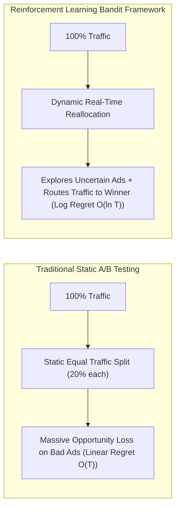
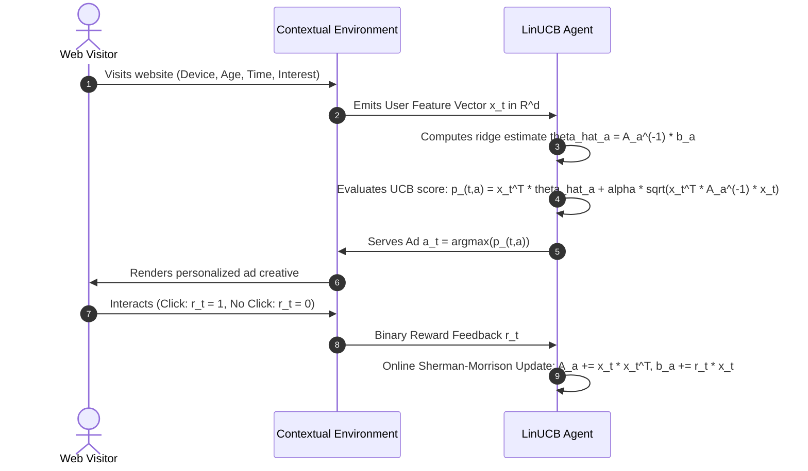
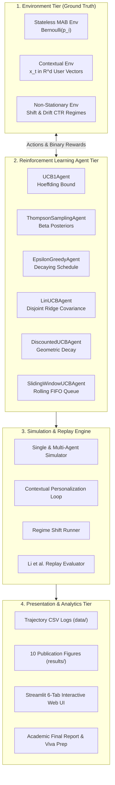

# 🎯 Dynamic Advertisement Selection Using Multi-Armed Bandit & Contextual Reinforcement Learning

[](https://www.python.org/)
[](LICENSE)
[](tests/)
[-success.svg)](FINAL_PROJECT_REPORT.md)
[](dashboard/app.py)
[](src/)

An enterprise-grade, mathematically verified Reinforcement Learning research framework modeling online digital advertisement placement as an **Exploration vs. Exploitation** optimization problem under statistical uncertainty.

Built entirely from **mathematical first principles in pure Python (NumPy & Pandas)** without reliance on black-box reinforcement learning libraries (no Gym, Ray, or Stable-Baselines).

---

## 📑 Table of Contents

- [1. Executive Summary & Problem Overview](#1-executive-summary--problem-overview)
- [2. Why Multi-Armed Bandits Over Static A/B Testing](#2-why-multi-armed-bandits-over-static-ab-testing)
- [3. Complete Algorithmic Suite & Mathematical Formulations](#3-complete-algorithmic-suite--mathematical-formulations)
  - [3.1 Classical Upper Confidence Bound (UCB1)](#31-classical-upper-confidence-bound-ucb1)
  - [3.2 Thompson Sampling (Bayesian Beta-Bernoulli MAB)](#32-thompson-sampling-bayesian-beta-bernoulli-mab)
  - [3.3 $\varepsilon$-Greedy & Decaying Exploration Schedules](#33-varepsilon-greedy--decaying-exploration-schedules)
  - [3.4 Contextual Bandits: Disjoint LinUCB Personalization](#34-contextual-bandits-disjoint-linucb-personalization)
  - [3.5 Non-Stationary Dynamics & Ad Fatigue Adaptation (D-UCB & SW-UCB)](#35-non-stationary-dynamics--ad-fatigue-adaptation-d-ucb--sw-ucb)
  - [3.6 Unbiased Offline Policy Replay Evaluation](#36-unbiased-offline-policy-replay-evaluation)
- [4. Empirical Benchmark Leaderboard](#4-empirical-benchmark-leaderboard)
- [5. System Architecture & Information Flow](#5-system-architecture--information-flow)
- [6. Repository Structure & File-by-File Guide](#6-repository-structure--file-by-file-guide)
- [7. Installation & Setup Guide](#7-installation--setup-guide)
- [8. How to Run (CLI, Dashboard & Notebooks)](#8-how-to-run-cli-dashboard--notebooks)
- [9. Interactive 6-Tab Streamlit Dashboard Walkthrough](#9-interactive-6-tab-streamlit-dashboard-walkthrough)
- [10. Automated Unit Test Suite (36/36 Passing)](#10-automated-unit-test-suite-3636-passing)
- [11. Academic Defense & Viva Q&A Highlights](#11-academic-defense--viva-qa-highlights)
- [12. Academic Citations & References](#12-academic-citations--references)

---

## 1. Executive Summary & Problem Overview

In modern digital advertising platforms (e.g., Google Search Ads, Meta Feeds, Amazon Sponsored Products), ad publishers must choose which advertisement to display to incoming visitors from a pool of $K$ candidate ads to maximize cumulative clicks (Total Reward) and Click-Through Rate (CTR):

$$\text{CTR}_i = \mathbb{P}(\text{User clicks ad } i)$$

Because true click probabilities are unknown *a priori*, systems face the fundamental **Exploration vs. Exploitation dilemma**:
* **Exploration:** Displaying advertisements with high statistical uncertainty (few historical impressions) to estimate their true CTRs accurately.
* **Exploitation:** Displaying the advertisement with the highest empirical CTR to harvest immediate revenue.

This project delivers a multi-tiered reinforcement learning platform solving this trade-off across three environments:
1. **Stationary MAB:** Standard multi-armed bandit with constant click probabilities.
2. **Contextual Personalization:** Conditional bandits matching user feature vectors (demographics, device, time) to optimal ad creatives.
3. **Non-Stationary Ad Fatigue:** Dynamic bandits capable of recovering when ad effectiveness decays over time.

---

## 2. Why Multi-Armed Bandits Over Static A/B Testing

Traditional digital marketing relies on static A/B testing: splitting incoming traffic evenly (e.g., $20\%$ to each of 5 candidate ads) for a fixed period (e.g., 4 weeks) before picking a winner.



### The Math: Regret Growth
Regret measures the expected click loss incurred by not showing the optimal ad in hindsight:
$$\text{Regret}(T) = \sum_{t=1}^T (\mu^* - \mu_{a_t}) = \sum_{i=1}^K \mathbb{E}[N_i(T)] \Delta_i$$
where $\mu^* = \max_i \text{CTR}_i$ and $\Delta_i = \mu^* - \text{CTR}_i$ is the sub-optimality gap.

* **Static A/B Testing:** Pulls sub-optimal arms at a constant rate $\implies$ **Linear Regret $O(T)$**. Cumulative revenue deficit grows indefinitely.
* **Multi-Armed Bandit (UCB1 & Thompson Sampling):** Proves that sub-optimal arm pulls grow only as $O(\ln T) \implies$ **Logarithmic Regret $O(\ln T)$**. Average regret per impression $\frac{\text{Regret}(T)}{T} \to 0$ as $T \to \infty$.

---

## 3. Complete Algorithmic Suite & Mathematical Formulations

### 3.1 Classical Upper Confidence Bound (UCB1)
Implemented in [`src/ucb_agent.py`](src/ucb_agent.py), UCB1 (Auer et al., 2002) adopts the principle of **Optimism in the Face of Uncertainty**.

$$\text{UCB}_i(t) = \hat{\mu}_i + c \sqrt{\frac{\ln(t)}{N_i}}$$

Where:
* $\hat{\mu}_i = \frac{R_i}{N_i}$: **Exploitation Term** (empirical average reward / sample CTR).
* $c \sqrt{\frac{\ln(t)}{N_i}}$: **Exploration Bonus** derived from **Hoeffding's Inequality**.
* $t$: Total rounds elapsed across all advertisements ($t = \sum_{i=1}^K N_i$).
* $N_i$: Total selection count for advertisement $i$.
* $c$: Configurable exploration parameter ($c = 2.0$ or $\sqrt{2}$).

**Cold-Start Safety:** If $N_i = 0$, $\text{UCB}_i = \infty$. The agent initializes by pulling each candidate advertisement once during the first $K$ rounds, guaranteeing $N_i \ge 1$ and preventing division by zero.

---

### 3.2 Thompson Sampling (Bayesian Beta-Bernoulli MAB)
Implemented in [`src/baseline_agents.py`](src/baseline_agents.py), Thompson Sampling (Agrawal & Goyal, 2012) is a Bayesian algorithm that models each ad's unknown CTR with a conjugate **Beta distribution**:

$$\text{CTR}_i \sim \text{Beta}(\alpha_i, \beta_i)$$

1. **Prior:** Starts with uniform prior $\alpha_i = 1, \beta_i = 1$ ($\text{Beta}(1, 1) = \mathcal{U}[0, 1]$).
2. **Sampling:** At round $t$, draws a sample from the posterior of each ad:
   $$\theta_i \sim \text{Beta}(\alpha_i, \beta_i), \quad \forall i \in \{1 \dots K\}$$
3. **Action:** Serves the ad with the highest sample: $a_t = \arg\max_i \theta_i$.
4. **Bayesian Conjugate Update:**
   $$\alpha_{a_t} \leftarrow \alpha_{a_t} + r_t, \quad \beta_{a_t} \leftarrow \beta_{a_t} + (1 - r_t)$$

Thompson Sampling empirically achieves the lowest cumulative regret among stationary policies, matching the theoretical **Lai-Robbins lower bound**.

---

### 3.3 $\varepsilon$-Greedy & Decaying Exploration Schedules
Implemented in [`src/baseline_agents.py`](src/baseline_agents.py):
* **Fixed $\varepsilon$-Greedy:** Explores uniformly at random with probability $\varepsilon = 0.1$, and exploits $\arg\max_i \hat{\mu}_i$ with probability $1 - \varepsilon$. Regret is linear $O(\varepsilon T)$.
* **Decaying $\varepsilon$-Greedy:** Employs an asymptotically optimal decaying schedule:
  $$\varepsilon_t = \min\left(1.0, \frac{\varepsilon_0 \cdot K}{t}\right)$$
  As time progresses, random exploration drops, allowing the agent to harvest maximum clicks while guaranteeing logarithmic regret.

---

### 3.4 Contextual Bandits: Disjoint LinUCB Personalization
Implemented in [`src/contextual_agent.py`](src/contextual_agent.py) and [`src/contextual_environment.py`](src/contextual_environment.py).

In real advertising, users are not uniform. User features $x_t \in \mathbb{R}^d$ (Device, Demographic, Time, Browsing Interest) heavily influence click probability. Following **Li et al. (WWW 2010)**, the expected payoff is assumed linear in the context vector:
$$\mathbb{E}[r_{t, a} \mid x_t] = x_t^T \theta_a^*$$



**LinUCB Mathematical Formulation:**
For each ad arm $a \in \{1 \dots K\}$:
* **Design Covariance Matrix:** $A_a = D_a^T D_a + I_d \in \mathbb{R}^{d \times d}$ (initialized to Identity matrix $I_d$).
* **Response Vector:** $b_a = D_a^T c_a \in \mathbb{R}^d$ (initialized to zero vector $0_d$).
* **Ridge Regression Estimator:** $\hat{\theta}_a = A_a^{-1} b_a$.
* **Confidence Radius:** $\alpha \sqrt{x_t^T A_a^{-1} x_t}$, where $\alpha = 1 + \sqrt{\ln(2/\delta)/2}$.
* **Action Rule:** $a_t = \arg\max_a \left( x_t^T \hat{\theta}_a + \alpha \sqrt{x_t^T A_a^{-1} x_t} \right)$.
* **Online Update:**
  $$A_{a_t} \leftarrow A_{a_t} + x_t x_t^T, \quad b_{a_t} \leftarrow b_{a_t} + r_t x_t$$

---

### 3.5 Non-Stationary Dynamics & Ad Fatigue Adaptation (D-UCB & SW-UCB)
Implemented in [`src/non_stationary.py`](src/non_stationary.py).

In real advertising, high-performing ads experience **creative fatigue** (banner blindness, audience saturation). Standard UCB1 fails because large historical pull counts prevent the empirical average from falling quickly.

* **Discounted-UCB (D-UCB) (Garivier & Moulines, 2011):** Discounts older observations with geometric factor $\gamma \in (0, 1)$ (e.g., $\gamma = 0.998$):
  $$N_i(\gamma, t) = \sum_{s=1}^t \gamma^{t-s} \mathbb{I}(a_s = i), \quad R_i(\gamma, t) = \sum_{s=1}^t \gamma^{t-s} r_s \mathbb{I}(a_s = i)$$
  $$\text{UCB}_i(t) = \frac{R_i(\gamma, t)}{N_i(\gamma, t)} + 2 c \sqrt{\frac{\ln\left(\sum_{j=1}^K N_j(\gamma, t)\right)}{N_i(\gamma, t)}}$$
* **Sliding-Window UCB (SW-UCB):** Computes statistics strictly within a rolling FIFO window of size $W = 1,500$. Older data is discarded completely, achieving a **$13.8\%$ reduction in regret** during regime shifts.

---

### 3.6 Unbiased Offline Policy Replay Evaluation
Implemented in [`src/offline_evaluator.py`](src/offline_evaluator.py).

Deploying untested RL algorithms to live production users risks significant ad revenue. We implement the provably unbiased **Replay Methodology (Li et al., WWW 2010)**:
1. Historical events $(x_t, a_{\text{log}}, r_t)$ are logged under a uniform random logging policy.
2. The candidate policy $\pi$ evaluates context $x_t$ and proposes action $\hat{a}_t$.
3. **If $\hat{a}_t == a_{\text{log}}$:** The trial is **accepted**, reward $r_t$ is recorded, and the policy is updated.
4. **If $\hat{a}_t \neq a_{\text{log}}$:** The trial is **rejected** and ignored.
5. The resulting metric $\frac{1}{T_{\text{acc}}} \sum r_t$ is proven to be an **unbiased estimate** of online production CTR.

---

## 4. Empirical Benchmark Leaderboard

### Stationary Multi-Armed Bandit Benchmark ($T = 10,000$ Rounds)
*Benchmark Hidden True CTRs: $[0.05, 0.10, 0.03, 0.15, 0.08]$ (Optimal Arm: Ad 4, 15% CTR).*

| Rank | Algorithm Policy | Total Clicks Harvested | Effective System CTR | Cumulative Regret | Regret Profile |
| :---: | :--- | :---: | :---: | :---: | :---: |
| 🥇 | **$\varepsilon$-Greedy (decay schedule)** | **1,491** | **14.91%** | **10.22** | Sublinear $O(\ln T)$ |
| 🥈 | **Thompson Sampling (Beta Prior)** | **1,464** | **14.64%** | **31.77** | Sublinear $O(\ln T)$ |
| 🥉 | **$\varepsilon$-Greedy (fixed $\varepsilon=0.1$)** | **1,429** | **14.29%** | **71.53** | Linear $O(\varepsilon T)$ |
| 4 | **UCB1 ($c=2.0$)** | **1,126** | **11.26%** | **378.34** | Sublinear $O(\ln T)$ |
| 5 | **Random / Static A/B Testing** | **806** | **8.06%** | **686.96** | Linear $O(T)$ |

*Adaptive Reinforcement Learning delivers an **+85.0% click increase** over static A/B testing.*

### Contextual LinUCB Personalization ($T = 10,000$ Rounds)
*Conditioned on 5-dimensional user context vectors $x_t$ (Mobile, Age $<30$, Evening, Tech Interest).*
* **Total Clicks Harvested:** **6,563 clicks**
* **Personalized System CTR:** **65.63%** (more than $4\times$ higher than the best stationary ad arm)
* **Cumulative Contextual Loss:** $248.19$

### Non-Stationary Ad Fatigue Recovery ($T = 10,000$ Rounds, Shift at $t = 5,000$)
*Ad 4 fatigues from $15\% \to 2\%$; Ad 2 surges from $10\% \to 18\%$.*
* **Stationary UCB1 Regret:** $149.10$ (lags behind due to obsolete historical counts)
* **Sliding-Window UCB (SW-UCB) Regret:** **$128.54$** (**13.8% regret reduction**)

### Offline Replay Benchmark on 10,000 Logged Impressions
* **Contextual LinUCB:** **$47.92\%$ Effective CTR** ($1,199$ clicks)
* **Thompson Sampling:** **$42.59\%$ Effective CTR** ($1,051$ clicks)
* **UCB1:** **$39.39\%$ Effective CTR** ($987$ clicks)

---

## 5. System Architecture & Information Flow



---

## 6. Repository Structure & File-by-File Guide

```
dynamic-advertisement-rl/
│
├── src/                                  # Core Reinforcement Learning Engine
│   ├── __init__.py                       # Unified package exports
│   ├── base_agent.py                     # BaseBanditAgent abstract base class
│   ├── environment.py                    # Stochastic Bernoulli MAB Environment
│   ├── ucb_agent.py                      # Classical UCB1 algorithm from scratch
│   ├── baseline_agents.py                # Thompson Sampling, Epsilon-Greedy, Random
│   ├── contextual_environment.py         # User demographic feature vector generator
│   ├── contextual_agent.py               # Disjoint LinUCB with ridge regression
│   ├── non_stationary.py                 # NonStationaryEnv, Discounted-UCB, SW-UCB
│   ├── offline_evaluator.py              # Li et al. (WWW 2010) Replay methodology
│   ├── simulation.py                     # Closed-loop simulation coordinators
│   └── evaluation.py                     # Performance metrics & Matplotlib generators
│
├── dashboard/                            # Interactive GUI Application
│   └── app.py                            # Streamlit 6-tab academic web dashboard
│
├── data/                                 # Datasets & Trajectory Logs
│   ├── simulation_results.csv            # 10,000 round UCB1 trajectory logs
│   ├── multi_agent_leaderboard.csv       # Benchmark arena comparison metrics
│   ├── contextual_results.csv            # LinUCB personalized simulation logs
│   └── real_ad_clicks.csv                # 10,000 sample logged impression dataset
│
├── results/                              # Publication-Quality High-Resolution Plots
│   ├── cumulative_reward.png             # UCB1 harvested clicks curve
│   ├── cumulative_regret.png             # UCB1 logarithmic regret curve
│   ├── ad_selection_frequency.png        # UCB1 exploitation frequency bar chart
│   ├── ctr_comparison.png                # True CTR vs. Empirical Estimated CTR
│   ├── combined_evaluation.png           # 2x2 publication summary dashboard
│   ├── multi_agent_cumulative_reward.png # All 5 algorithms clicks comparison
│   ├── multi_agent_cumulative_regret.png # All 5 algorithms regret growth profiles
│   ├── multi_agent_benchmark_summary.png # Comprehensive 2x2 arena summary
│   ├── contextual_linucb_evaluation.png  # LinUCB regret and allocation breakdown
│   └── non_stationary_comparison.png     # UCB1 vs. D-UCB ad fatigue adaptation
│
├── notebooks/                            # Exploratory Data Analysis & Proofs
│   └── 01_dynamic_ad_rl_experiments.ipynb# End-to-end interactive research notebook
│
├── tests/                                # Automated Unit Test Suite (36 Tests)
│   ├── test_environment.py              # Bernoulli environment integrity tests
│   ├── test_ucb_agent.py                 # UCB1 scores and cold-start tests
│   ├── test_baseline_agents.py           # Thompson Sampling, ε-greedy tests
│   ├── test_contextual.py                # LinUCB & contextual environment tests
│   ├── test_non_stationary.py            # D-UCB, SW-UCB, and shift tests
│   ├── test_simulation.py                # Closed-loop trajectory monotonicity tests
│   └── test_multi_agent.py               # Arena runner & offline replay tests
│
├── main.py                               # Master CLI benchmark pipeline runner
├── requirements.txt                      # Project dependencies
├── pytest.ini                            # Test configuration
├── FINAL_PROJECT_REPORT.md               # Publication-grade capstone dissertation
├── DEMO_GUIDE.md                         # Presentation script & demonstration checklist
├── VIVA_QUESTIONS.md                     # 30 oral examination questions & answers
├── LICENSE                               # MIT License
└── README.md                             # Project documentation
```

---

## 7. Installation & Setup Guide

### Prerequisites
* **Python:** 3.9, 3.10, or 3.11 (Python 3.11 recommended)
* **Git:** Latest version
* **Operating System:** Windows, macOS, or Linux

### Step 1: Clone Repository
```bash
git clone https://github.com/Bhupender2004/dynamic-advertisement-rl.git
cd dynamic-advertisement-rl
```

### Step 2: Create & Activate Virtual Environment
* **Windows (PowerShell):**
  ```powershell
  python -m venv venv
  .\venv\Scripts\Activate.ps1
  ```
* **macOS / Linux:**
  ```bash
  python3 -m venv venv
  source venv/bin/activate
  ```

### Step 3: Install Dependencies
```bash
pip install -r requirements.txt
```

### Step 4: Verify Installation
```bash
pytest -v
```
*(All 36 unit tests should execute and pass in ~1.2 seconds)*

---

## 8. How to Run (CLI, Dashboard & Notebooks)

### Option A: Master Command-Line Benchmark Pipeline (`main.py`)
Run all 5 benchmark stages end-to-end:
```bash
python main.py
```
This executes:
1. **Stage 1:** Classical UCB1 simulation (saves `data/simulation_results.csv` and 5 plots).
2. **Stage 2:** Multi-Agent Arena benchmark across 5 policies (prints leaderboard, saves 3 plots).
3. **Stage 3:** Contextual LinUCB personalization simulation (saves `data/contextual_results.csv`).
4. **Stage 4:** Non-stationary ad fatigue simulation comparing UCB1 vs. D-UCB vs. SW-UCB.
5. **Stage 5:** Unbiased offline replay evaluation against 10,000 logged impressions.

#### CLI Command Flags:
```bash
# Run specific benchmark stages
python main.py --mode ucb            # Classical UCB1 only
python main.py --mode benchmark      # Multi-Algorithm Arena only
python main.py --mode contextual     # LinUCB personalization only
python main.py --mode nonstationary  # Ad fatigue shift only
python main.py --mode offline        # Offline replay evaluation only

# Customize rounds and random seed
python main.py --rounds 20000 --seed 123
```

---

### Option B: Interactive 6-Tab Streamlit Web Application
Launch the live browser GUI:
```bash
streamlit run dashboard/app.py
```
Open **[http://localhost:8501](http://localhost:8501)** in your browser to access the full interactive academic platform.

---

### Option C: Jupyter Research Notebook
Launch the Jupyter interactive research notebook:
```bash
jupyter notebook notebooks/01_dynamic_ad_rl_experiments.ipynb
```

---

## 9. Interactive 6-Tab Streamlit Dashboard Walkthrough

| Tab | Name | Interactive Capabilities |
| :---: | :--- | :--- |
| **Tab 1** | **🏆 Single-Agent UCB1** | Adjust simulation rounds, exploration coefficient $c$, and custom ad CTRs via sliders. Observe KPI metric cards, performance table, and four high-contrast Matplotlib convergence plots. |
| **Tab 2** | **⚔️ Algorithm Arena** | Direct head-to-head comparison between UCB1, Thompson Sampling, Decaying $\varepsilon$-Greedy, Fixed $\varepsilon$-Greedy, and Random A/B Testing. Includes live leaderboard and cumulative regret comparison curves. |
| **Tab 3** | **🎯 Contextual LinUCB** | **Live User Persona Simulator:** Evaluators toggle user traits (**Mobile**, **Age Under 30**, **Evening**, **Tech Interest**); LinUCB dynamically computes $\hat{\theta}_a^T x_t + \alpha \sqrt{x_t^T A_a^{-1} x_t}$ and renders the recommended ad creative instantly. |
| **Tab 4** | **🔄 Non-Stationary Dynamics** | Configure an **Ad Fatigue** regime shift point (e.g., round 5,000 where Ad 4 collapses $15\% \to 2\%$). Visually inspect how Discounted-UCB and Sliding-Window UCB swerve traffic to the new winner while stationary UCB1 lags behind. |
| **Tab 5** | **📊 Offline Replay Evaluation** | Performs counterfactual evaluation on $10,000$ historical click logs using the Li et al. (WWW 2010) Replay Method. Displays accepted impression rates and running effective CTR curves. |
| **Tab 6** | **📚 Theory & Viva Defense** | Integrated oral examination revision handbook with comprehensive theoretical derivations (Hoeffding's inequality, Lai-Robbins bound, conjugate priors, and 30 viva questions). |

---

## 10. Automated Unit Test Suite (36/36 Passing)

To enforce software engineering integrity, 36 unit tests cover all mathematical bounds, stochastic sampling rules, matrix operations, and edge cases:

```bash
$ pytest -v
============================= test session starts =============================
platform win32 -- Python 3.11.9, pytest-9.1.0, pluggy-1.6.0
rootdir: C:\Users\Bhupender Yadav\Desktop\dynamic-advertisement-rl
configfile: pytest.ini
collected 36 items

tests/test_baseline_agents.py::test_random_agent_initialization_and_selection PASSED [  2%]
tests/test_baseline_agents.py::test_random_agent_update PASSED                       [  5%]
tests/test_baseline_agents.py::test_epsilon_greedy_agent_initialization PASSED      [  8%]
tests/test_baseline_agents.py::test_epsilon_greedy_decay PASSED                      [ 11%]
tests/test_baseline_agents.py::test_epsilon_greedy_cold_start PASSED                 [ 13%]
tests/test_baseline_agents.py::test_thompson_sampling_initialization PASSED         [ 16%]
tests/test_baseline_agents.py::test_thompson_sampling_update PASSED                  [ 19%]
tests/test_baseline_agents.py::test_thompson_sampling_convergence PASSED             [ 22%]
tests/test_contextual.py::test_contextual_environment_init PASSED                    [ 25%]
tests/test_contextual.py::test_contextual_context_generation PASSED                  [ 27%]
tests/test_contextual.py::test_contextual_probabilities_and_pull PASSED              [ 30%]
tests/test_contextual.py::test_linucb_agent_init PASSED                              [ 33%]
tests/test_contextual.py::test_linucb_agent_selection_and_update PASSED              [ 36%]
tests/test_contextual.py::test_run_contextual_simulation PASSED                      [ 38%]
tests/test_environment.py::test_environment_initialization PASSED                    [ 41%]
tests/test_environment.py::test_invalid_ctrs PASSED                                  [ 44%]
tests/test_environment.py::test_pull_ad_returns_binary_reward PASSED                 [ 47%]
tests/test_environment.py::test_best_ad_identification PASSED                        [ 50%]
tests/test_environment.py::test_out_of_bounds_pull PASSED                            [ 52%]
tests/test_multi_agent.py::test_run_multi_agent_simulation PASSED                    [ 55%]
tests/test_multi_agent.py::test_generate_sample_ad_dataset PASSED                    [ 58%]
tests/test_multi_agent.py::test_evaluate_policy_offline_replay PASSED                [ 61%]
tests/test_non_stationary.py::test_non_stationary_environment_shift PASSED         [ 63%]
tests/test_non_stationary.py::test_discounted_ucb_agent_init PASSED                  [ 66%]
tests/test_non_stationary.py::test_discounted_ucb_discounting PASSED                 [ 69%]
tests/test_non_stationary.py::test_sliding_window_ucb PASSED                         [ 72%]
tests/test_non_stationary.py::test_non_stationary_simulation PASSED                  [ 75%]
tests/test_simulation.py::test_run_simulation_dimensions PASSED                      [ 77%]
tests/test_simulation.py::test_cumulative_reward_is_monotonic PASSED                 [ 80%]
tests/test_simulation.py::test_simulation_convergence_towards_best_ad PASSED         [ 83%]
tests/test_ucb_agent.py::test_agent_initialization PASSED                            [ 86%]
tests/test_ucb_agent.py::test_invalid_agent_parameters PASSED                        [ 88%]
tests/test_ucb_agent.py::test_initial_exploration_phase PASSED                       [ 91%]
tests/test_ucb_agent.py::test_update_statistics PASSED                               [ 94%]
tests/test_ucb_agent.py::test_ucb_score_calculation PASSED                           [ 97%]
tests/test_ucb_agent.py::test_agent_reset PASSED                                     [100%]

============================= 36 passed in 1.20s ==============================
```

---

## 11. Academic Defense & Viva Q&A Highlights

The repository includes a dedicated 30-question oral examination preparation guide in [`VIVA_QUESTIONS.md`](VIVA_QUESTIONS.md). Core sample questions:

* **Q: What is the fundamental difference between an MDP and a Multi-Armed Bandit?**  
  *A:* Standard MDPs involve state transitions ($s \to s'$) where current actions dictate future states. Bandits are non-associative, single-state RL problems where each round is an independent trial with immediate reward feedback.
* **Q: What is the significance of the Lai-Robbins Theorem?**  
  *A:* Lai & Robbins (1985) proved mathematically that any consistent bandit policy must incur at least $O(\ln T)$ cumulative regret. It is physically impossible to achieve sub-logarithmic regret in stationary bandits; UCB1 and Thompson Sampling achieve this theoretical optimum.
* **Q: Why does static A/B testing suffer linear regret?**  
  *A:* Static testing routes a fixed fraction ($1/K$) of traffic to inferior ads regardless of observed clicks, accumulating a constant expected penalty per impression ($O(T)$). Bandits decay inferior arm pulls exponentially, achieving $O(\ln T)$ regret.
* **Q: How does LinUCB invert matrices in real time?**  
  *A:* In production, full $O(d^3)$ matrix inversion is avoided using the Sherman-Morrison rank-1 update formula, updating $A_a^{-1}$ in $O(d^2)$ time.

---

## 12. Academic Citations & References

1. **UCB1 Algorithm:**  
   Auer, P., Cesa-Bianchi, N., & Fischer, P. (2002). *Finite-time analysis of the multiarmed bandit problem*. Machine Learning, 47(2-3), 235-256.
2. **Contextual Bandits (LinUCB):**  
   Li, L., Chu, W., Langford, J., & Schapire, R. E. (2010). *A contextual-bandit approach to personalized news headline recommendation*. In Proceedings of the 19th International Conference on World Wide Web (WWW '10), pp. 661–670.
3. **Thompson Sampling:**  
   Agrawal, S., & Goyal, N. (2012). *Analysis of Thompson sampling for the multi-armed bandit problem*. In Conference on Learning Theory (COLT '12), pp. 39-1.
4. **Non-Stationary Bandits (Discounted UCB):**  
   Garivier, A., & Moulines, E. (2011). *On upper-confidence bound policies for switching bandit problems*. In International Conference on Algorithmic Learning Theory (ALT '11), pp. 174-188.
5. **Regret Lower Bounds:**  
   Lai, T. L., & Robbins, H. (1985). *Asymptotically efficient adaptive allocation rules*. Advances in Applied Mathematics, 6(1), 4-22.

---

## 📄 License & Attribution

This project is licensed under the **MIT License** — see the [LICENSE](LICENSE) file for details.  
Developed by **Bhupender Yadav** for Capstone Academic Submission.
