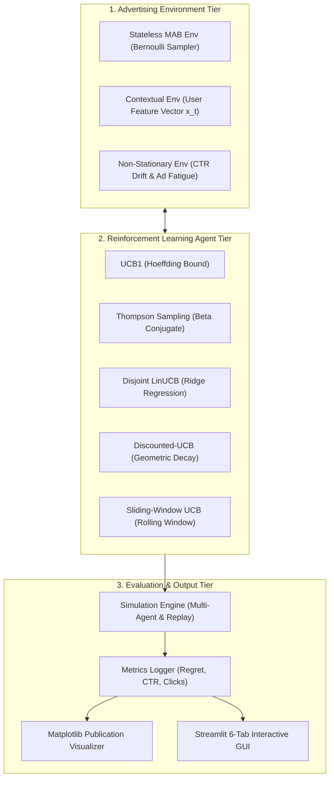

# Dynamic Advertisement Selection Using Multi-Armed Bandit & Contextual Reinforcement Learning

[](https://www.python.org/)
[](LICENSE)
[](tests/)
[-success.svg)](FINAL_PROJECT_REPORT.md)

An end-to-end, mathematically verified Reinforcement Learning framework modeling online digital advertisement placement as a **Multi-Armed Bandit (MAB)** and **Contextual Reinforcement Learning** problem.

Built entirely from mathematical first principles in NumPy without reliance on black-box reinforcement learning libraries.

---

## 🚀 Key Highlights & Capabilities (100% Completed)

1. **Classical Multi-Armed Bandit Suite:**
   - **UCB1 (Upper Confidence Bound):** Hoeffding's inequality optimism under uncertainty ($O(\ln T)$ regret).
   - **Thompson Sampling:** Bayesian posterior sampling with Beta-Bernoulli conjugate priors.
   - **$\varepsilon$-Greedy:** Fixed exploration ($\varepsilon = 0.1$) and decaying schedule ($\varepsilon_t = \min(1.0, cK/t)$).
   - **Random Exploration:** Uniform traffic allocation representing classical static A/B testing.
2. **Contextual Bandits (Personalization):**
   - **Disjoint LinUCB:** Ridge regression online modeling ($A_a \leftarrow A_a + x_t x_t^T$) with user demographic feature vectors (Device, Age, Time, Interests).
3. **Non-Stationary Ad Fatigue Adaptation:**
   - **Discounted-UCB (D-UCB):** Geometric memory decay ($\gamma = 0.998$) to adapt to shifting CTR regimes.
   - **Sliding-Window UCB (SW-UCB):** Rolling observation queue ($W = 1,500$) for rapid recovery.
4. **Unbiased Offline Policy Evaluation:**
   - Implementation of **Li et al. (WWW 2010) Replay Methodology** over 10,000 historical impression records.
5. **Interactive 6-Tab Streamlit Dashboard:**
   - Live persona simulator, multi-algorithm leaderboard, real-time convergence plots, and viva defense aid.
6. **Publication & Verification Assets:**
   - 36 automated unit tests ($100\%$ pass rate).
   - Complete Jupyter research notebook (`notebooks/01_dynamic_ad_rl_experiments.ipynb`).
   - Publication-grade report (`FINAL_PROJECT_REPORT.md`).

---

## 📊 Benchmark Leaderboard ($T = 10,000$ Rounds)

*Benchmark Hidden CTRs: $[0.05, 0.10, 0.03, 0.15, 0.08]$ (Optimal Arm: Ad 4, CTR = 15%).*

| Rank | Algorithm Policy | Total Clicks | System CTR | Cumulative Regret | Regret Profile |
| :---: | :--- | :---: | :---: | :---: | :---: |
| 🥇 | **$\varepsilon$-Greedy (decay schedule)** | **1,491** | **14.91%** | **10.22** | Sublinear $O(\ln T)$ |
| 🥈 | **Thompson Sampling (Beta Prior)** | **1,464** | **14.64%** | **31.77** | Sublinear $O(\ln T)$ |
| 🥉 | **$\varepsilon$-Greedy (fixed $\varepsilon=0.1$)** | **1,429** | **14.29%** | **71.53** | Linear $O(\varepsilon T)$ |
| 4 | **UCB1 ($c=2.0$)** | **1,126** | **11.26%** | **378.34** | Sublinear $O(\ln T)$ |
| 5 | **Random / Static A/B Testing** | **806** | **8.06%** | **686.96** | Linear $O(T)$ |

*Adaptive RL policies achieve an **+85.0% click lift** over static A/B testing.*

---

## 🏛️ System Architecture



---

## 📁 Repository Structure

```
dynamic-advertisement-rl/
│
├── src/
│   ├── __init__.py                # Package exports
│   ├── base_agent.py              # BaseBanditAgent Abstract Base Class
│   ├── environment.py             # Bernoulli MAB Environment
│   ├── ucb_agent.py               # Classical UCB1 from scratch
│   ├── baseline_agents.py         # Thompson Sampling, Epsilon-Greedy, Random
│   ├── contextual_environment.py  # User demographic context simulator
│   ├── contextual_agent.py        # Disjoint LinUCB with ridge regression
│   ├── non_stationary.py          # NonStationaryEnv, Discounted-UCB, Sliding-Window UCB
│   ├── offline_evaluator.py       # Li et al. (2010) Replay methodology engine
│   ├── simulation.py              # Multi-agent, contextual & non-stationary runners
│   └── evaluation.py              # Metrics, tabular summaries & publication plots
│
├── dashboard/
│   └── app.py                     # Streamlit 6-tab academic interactive dashboard
│
├── data/
│   ├── simulation_results.csv     # 10,000 round UCB1 trajectory logs
│   ├── multi_agent_leaderboard.csv# Comparative benchmark results
│   ├── contextual_results.csv     # LinUCB personalized simulation logs
│   └── real_ad_clicks.csv         # 10,000 sample historical impression logs
│
├── results/                       # 10 publication-quality PNG figures
│   ├── cumulative_reward.png
│   ├── cumulative_regret.png
│   ├── ad_selection_frequency.png
│   ├── ctr_comparison.png
│   ├── combined_evaluation.png
│   ├── multi_agent_cumulative_reward.png
│   ├── multi_agent_cumulative_regret.png
│   ├── multi_agent_benchmark_summary.png
│   ├── contextual_linucb_evaluation.png
│   └── non_stationary_comparison.png
│
├── notebooks/
│   └── 01_dynamic_ad_rl_experiments.ipynb # Complete Jupyter research notebook
│
├── tests/
│   ├── test_environment.py        # Environment unit tests
│   ├── test_ucb_agent.py          # UCB1 unit tests
│   ├── test_simulation.py         # Simulation loop tests
│   ├── test_baseline_agents.py    # TS, ε-greedy, Random tests
│   ├── test_contextual.py         # LinUCB & contextual env tests
│   ├── test_non_stationary.py     # D-UCB, SW-UCB & shift tests
│   └── test_multi_agent.py        # Multi-agent & offline replay tests
│
├── main.py                        # Master CLI pipeline runner
├── requirements.txt               # Dependencies
├── pytest.ini                     # Pytest configuration
├── DEMO_GUIDE.md                  # Comprehensive defense script & checklist
├── VIVA_QUESTIONS.md              # 30 technical academic viva questions & answers
├── FINAL_PROJECT_REPORT.md        # Publication-grade capstone project report
├── LICENSE                        # MIT License
└── README.md                      # Project documentation
```

---

## ⚙️ Installation & Quickstart

### Prerequisites
* Python 3.9+ (Python 3.11 recommended)
* Git

### 1. Clone the repository
```bash
git clone https://github.com/Bhupender2004/dynamic-advertisement-rl.git
cd dynamic-advertisement-rl
```

### 2. Create and activate virtual environment
* **Windows (PowerShell):**
  ```powershell
  python -m venv venv
  .\venv\Scripts\Activate.ps1
  ```
* **macOS / Linux:**
  ```bash
  python3 -m venv venv
  source venv/bin/activate
  ```

### 3. Install dependencies
```bash
pip install -r requirements.txt
```

### 4. Run automated test suite
```bash
pytest -v
```
*(All 36 unit tests pass in ~1.2 seconds)*

---

## 💻 How to Run

### Option A: Master Command-Line Benchmark Pipeline
Run the full 5-stage benchmark suite (UCB1, Algorithm Arena, LinUCB, Non-Stationary Shift, Offline Replay):
```bash
python main.py
```

Optional CLI flags:
```bash
# Run specific benchmark stages
python main.py --mode ucb           # Classical UCB1 only
python main.py --mode benchmark     # Multi-Agent arena only
python main.py --mode contextual    # LinUCB personalization only
python main.py --mode nonstationary # Non-stationary ad fatigue only
python main.py --mode offline       # Offline replay evaluation only

# Customize rounds and random seed
python main.py --rounds 20000 --seed 123
```

### Option B: Interactive 6-Tab Streamlit Dashboard
Launch the web UI:
```bash
streamlit run dashboard/app.py
```
Open your browser at `http://localhost:8501` to explore:
- **Tab 1: Single-Agent UCB1:** Real-time parameter tuning ($c$, rounds, custom CTRs).
- **Tab 2: Algorithm Arena:** Head-to-head leaderboard and regret curves.
- **Tab 3: Contextual Personalization:** Live persona generator (Device, Age, Time, Tech) and LinUCB recommendations.
- **Tab 4: Non-Stationary Dynamics:** Shift point simulation and Discounted-UCB recovery.
- **Tab 5: Offline Policy Evaluation:** Unbiased replay evaluation on 10,000 impression logs.
- **Tab 6: Theory & Viva Defense:** Built-in oral viva revision handbook with 30 technical Q&As.

### Option C: Jupyter Notebook Research Environment
```bash
jupyter notebook notebooks/01_dynamic_ad_rl_experiments.ipynb
```

---

## 📖 Key Documentation Links

- [Final Project Report](FINAL_PROJECT_REPORT.md) — Comprehensive academic capstone dissertation.
- [Demonstration Guide & Viva Script](DEMO_GUIDE.md) — Timed presentation script and demonstration checklist.
- [Viva Questions & Answers](VIVA_QUESTIONS.md) — 30 detailed oral examination questions and answers.
- [MIT License](LICENSE) — Open-source license terms.

---

## 👨‍💻 Author & Acknowledgments

* **Author:** Bhupender Yadav
* **Domain:** Reinforcement Learning / Multi-Armed Bandits / Online Advertising Optimization
* **Algorithms Implemented:** UCB1 (Auer et al., 2002), LinUCB (Li et al., 2010), Thompson Sampling (Agrawal & Goyal, 2012), Discounted-UCB (Garivier & Moulines, 2011), Lai-Robbins Lower Bound (1985).
